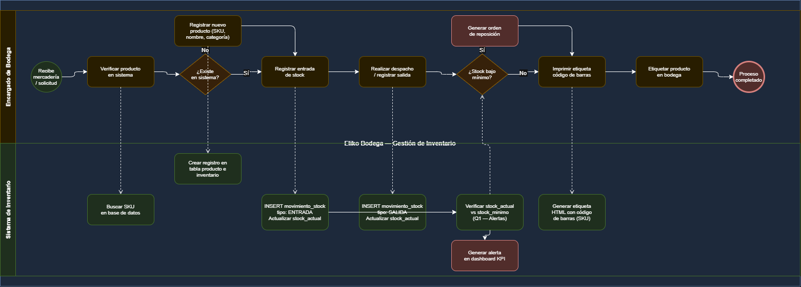

# 02 — Procesos de negocio (BPMN)

## Entrega 1

## 2.1 Modelo AS-IS (Proceso Actual)

## 2.2 Modelo TO-BE (Proceso Propuesto con SIG)

## 2.3 Explicación de Mejoras

Con la implementación del nuevo sistema (SIG), el flujo operativo de Electroliko pasa de ser reactivo a uno preventivo. Estas son las mejoras principales:

### Qué se automatiza
El descuento del stock. Ahora el sistema actualiza el inventario de forma automática cada vez que entra una venta de los canales integrados. Esto ocurre en paralelo a la preparación del pedido, lo que evita que vendamos productos cuando queda solo una unidad y nos ahorra tener que actualizar las plataformas manualmente.

### Qué se controla
Los quiebres de inventario. Eliminamos la revisión visual en la bodega. Ahora el sistema controla los niveles en tiempo real y lanza alertas automáticas cuando un producto cae bajo el umbral mínimo configurado. Así, Alejandro puede priorizar la reposición antes de quedarse sin stock. Para las ventas de canales sin integración, dejamos un punto de registro manual en el sistema para mantener el control.

### Qué se mide
La rotación de los productos y el impacto de las cancelaciones. A través de un módulo automático, el sistema genera reportes semanales que entregan información clara para decidir qué productos comprar primero a los proveedores y medir las pérdidas por falta de stock.

---

## Entrega 2 — BPMN to-be final

Fuente editable: [`../assets/bpmn_inventario_eliko.drawio`](../assets/bpmn_inventario_eliko.drawio)

### Proceso modelado

**Gestión de Inventario en Bodega**, con dos carriles: *Encargado de Bodega* y *Sistema de Inventario*.

| Paso | Elemento BPMN | Implementación en el sistema |
|---|---|---|
| 1 | Inicio: llega mercadería o se despacha un pedido | Acción del encargado |
| 2 | Gateway XOR **¿Existe en sistema?** — No: registrar producto | `INSERT INTO producto` + `INSERT INTO inventario` |
| 3 | Registrar entrada / salida | `INSERT INTO movimiento_stock` (ENTRADA / SALIDA) |
| 4 | Actualizar stock | `UPDATE inventario SET stock_actual = ...` |
| 5 | Gateway XOR **¿Stock bajo mínimo?** | `stock_minimo IS NOT NULL AND stock_actual < stock_minimo` |
| 6 | Tarea **Generar alerta** (Sí) | Tabla de alertas en el dashboard + **flujo n8n** con correo diario ([`05-automatizacion-n8n.md`](05-automatizacion-n8n.md)) |
| 7 | Fin: inventario actualizado | El dashboard refleja el estado actual |

> Estado actual: los pasos 3 y 4 están modelados en la base de datos, pero el dashboard todavía no tiene formulario para registrarlos; hoy se hacen por SQL.

### Cambios respecto del to-be de la Entrega 1

| Cambio | Detalle |
|---|---|
| Se mantiene | El carril del sistema que descuenta stock, evalúa el umbral y genera la alerta |
| Se simplifica | Los carriles humanos (Alejandro, pareja, operador) se agrupan en el *Encargado de Bodega* |
| Se agrega | Gateway "¿Existe en sistema?", que asegura la integridad referencial |
| Se automatiza | "Generar alerta" con n8n (en la E1 estaba planificada con `node-cron`) |
| Se posterga | Recepción de ventas desde los canales y reporte semanal de cancelaciones |
