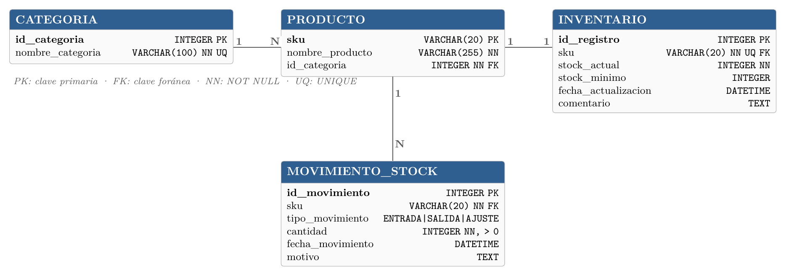

# 03 — Modelo de datos (ER en 3FN)

Diagrama: [`../assets/ER-E2.png`](../assets/ER-E2.png) · Script: [`../schema.sql`](../schema.sql) · Modelo preliminar de la E1: [`parte_4.md`](parte_4.md)

## Relaciones

| Relación | Cardinalidad | Regla que la asegura |
|---|---|---|
| CATEGORIA → PRODUCTO | 1 : N | `producto.id_categoria` es FK NOT NULL |
| PRODUCTO → INVENTARIO | 1 : 1 | `inventario.sku` es FK y UNIQUE |
| PRODUCTO → MOVIMIENTO_STOCK | 1 : N | `movimiento_stock.sku` es FK NOT NULL |

## Diccionario de datos

### `categoria`

| Atributo | Tipo / regla | Descripción |
|---|---|---|
| `id_categoria` | INTEGER, PK, autoincremental | Identificador de la categoría |
| `nombre_categoria` | VARCHAR(100), NOT NULL, UNIQUE | Nombre (ej.: Hogar y jardín). UNIQUE evita duplicados |

### `producto`

| Atributo | Tipo / regla | Descripción |
|---|---|---|
| `sku` | VARCHAR(20), PK | Código de bodega (ej.: HOG001). Cada variante tiene su propio SKU (ej.: CTR007G) |
| `nombre_producto` | VARCHAR(255), NOT NULL | Nombre descriptivo |
| `id_categoria` | INTEGER, NOT NULL, FK → `categoria` | Categoría del producto |

### `inventario`

| Atributo | Tipo / regla | Descripción |
|---|---|---|
| `id_registro` | INTEGER, PK, autoincremental | Identificador del registro de stock |
| `sku` | VARCHAR(20), NOT NULL, UNIQUE, FK → `producto` | Producto al que corresponde (uno a uno) |
| `stock_actual` | INTEGER, NOT NULL, DEFAULT 0 | Unidades disponibles en bodega |
| `stock_minimo` | INTEGER, puede ser NULL | Umbral de alerta; NULL = sin umbral definido |
| `fecha_actualizacion` | DATETIME | Último conteo o actualización |
| `comentario` | TEXT | Observaciones del conteo |

### `movimiento_stock`

| Atributo | Tipo / regla | Descripción |
|---|---|---|
| `id_movimiento` | INTEGER, PK, autoincremental | Identificador del movimiento |
| `sku` | VARCHAR(20), NOT NULL, FK → `producto` | Producto movido |
| `tipo_movimiento` | CHECK IN ('ENTRADA','SALIDA','AJUSTE') | Tipo de movimiento |
| `cantidad` | INTEGER, NOT NULL, CHECK > 0 | Unidades movidas |
| `fecha_movimiento` | DATETIME, DEFAULT CURRENT_TIMESTAMP | Fecha y hora |
| `motivo` | TEXT | Venta, recepción, corrección de conteo, etc. |

Índices: `idx_producto_categoria`, `idx_movimiento_sku` e `idx_movimiento_fecha`.

## Normalización

| Forma | Verificación |
|---|---|
| 1FN | Atributos atómicos; los movimientos son filas de `movimiento_stock`, no columnas repetidas en `producto` |
| 2FN | Todas las PK son simples, por lo que no hay dependencias parciales |
| 3FN | Sin dependencias transitivas: el nombre de la categoría vive solo en `categoria`, y el stock depende solo del registro de `inventario` de ese SKU |

### Anomalías evitadas

- **Actualización:** si la categoría fuera texto dentro de `producto`, renombrarla obligaría a modificar hasta 194 filas (Hogar y jardín). Con `categoria` se cambia un solo registro.
- **Inserción:** la FK impide registrar movimientos de un SKU inexistente; por eso el BPMN exige registrar primero el producto.
- **Datos inválidos:** los CHECK rechazan tipos de movimiento desconocidos y cantidades ≤ 0.

### Decisiones de diseño

- **`inventario` separado de `producto`:** el catálogo casi no cambia; el stock cambia con cada conteo o movimiento. Separarlos permite actualizar el stock sin tocar el catálogo y guardar la fecha y el comentario de cada conteo.
- **`stock_actual` almacenado:** podría calcularse sumando movimientos, pero el punto de partida es un conteo físico, no un historial. Las diferencias se corrigen con un movimiento AJUSTE, que deja trazabilidad.
- **Alertas calculadas, no almacenadas:** la alerta se obtiene con una consulta, así nunca queda desactualizada.

## Evolución desde la Entrega 1

| Entidad E1 | En la E2 |
|---|---|
| Producto | `producto` (SKU como PK) |
| Variante | Integrada en `producto`: cada variante tiene su propio SKU |
| stock (en Variante) | Tabla nueva `inventario` (1:1 con `producto`) |
| categoría (atributo) | Entidad `categoria` |
| IngresoStock, Venta/DetalleVenta | `movimiento_stock` (ENTRADA / SALIDA / AJUSTE) |
| AlertaStock | Consulta SQL |
| Canal, Publicación, Proveedor, Cancelación | Diferidas |
